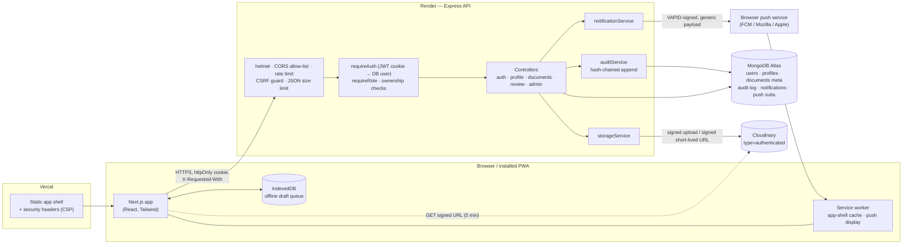

# Architecture

The portal is two independently deployable apps — a Next.js PWA and an Express REST API — backed by MongoDB Atlas, with documents in Cloudinary and notifications via Web Push.

## Components

**Next.js PWA (frontend, Vercel).** Renders every screen client-side and talks only to the API. It never sees the session token (httpOnly cookie) and makes no authorisation decisions; its route guards exist only to avoid showing screens that would return 403. It sends CSP, `nosniff`, referrer and permissions-policy headers.

**Service worker.** Precaches the app shell (pages plus the hashed JS/CSS they reference) so the onboarding wizard opens with no network. It caches same-origin static assets only. API responses come from another origin and are never cached, so no personal data is kept in Cache Storage. It also displays push notifications and opens the app when one is clicked.

**IndexedDB offline queue.** When a step is saved offline, the step data goes into a queue with an idempotency key and a client timestamp. The wizard replays the queue when the browser comes back online or the page loads. The server ignores duplicate keys and refuses to let an older save overwrite a newer one. The queue and cached profile are cleared on logout, on erasure, and when a different user signs in.

**Express API (backend, Render).** Requests pass through a fixed middleware order:
1. `helmet` sets security headers.
2. CORS allows only the configured frontend origin, with credentials.
3. A per-IP rate limit applies to all routes, with a stricter limit on auth.
4. A CSRF guard checks the Origin allow-list and requires the custom header on unsafe methods.
5. A 100 KB JSON limit applies.
6. `requireAuth` verifies the JWT and **reloads the user from the database**, so role changes and deactivations take effect immediately.
7. `requireRole(...)` checks the role. Controllers also check ownership.

Every write route validates its body with a `zod` schema. These schemas are `.strict()`, so unknown keys are rejected, which prevents mass assignment.

**auditService.** The only code that writes to the audit log. Each entry stores `prevHash` and `hash = SHA-256(prevHash + canonicalJSON(entry))`. A unique `seq` index stops two writers from forking the chain, and Mongoose hooks block updates and deletes. `GET /api/audit/verify` walks the whole chain and reports the first broken entry.

**storageService.** The only code that knows about Cloudinary. Files are validated in memory (extension, declared MIME type and magic bytes all have to agree, max 5 MB), hashed with SHA-256, then uploaded as `type: "authenticated"` with a random `public_id`. Cloudinary therefore refuses unsigned delivery. Downloads go through `GET /api/documents/:id/file`, which re-checks role and ownership, writes an audit entry, and returns a signed URL that expires in 5 minutes. Moving to S3/GCS means rewriting this one file.

**notificationService.** On every vetting status change it writes an in-app notification. This is the fallback that works without push permission. It then sends a VAPID-signed Web Push to each of the user's subscriptions and removes subscriptions the push service reports as expired (404/410). Push payloads are deliberately generic ("Your vetting status is now: Verified") because they pass through third-party push services. Reviewer notes appear only in the authenticated in-app list.

**MongoDB Atlas.** The system of record. Atlas encrypts data at rest and supports network allow-listing (open to `0.0.0.0/0` for the PoC; see README).

## Key flows

| Flow | Path |
|---|---|
| Login | POST `/auth/login` → bcrypt compare (dummy hash if the email is unknown, so timing does not reveal which emails exist) → audit `auth.login` / `auth.login_failed` → httpOnly cookie set |
| Save step | PUT `/profile/me/step/:n` + `Idempotency-Key` → zod validation → stale/duplicate check → save → audit `profile.step_saved` |
| Submit | POST `/profile/me/submit` → all steps re-validated server-side + CV & ID present + vetting consent granted → `Submitted` → audit |
| Review | POST `/review/:id/status` → transition table check → note required for MIR/Rejected → conditional update on current status (no lost updates) → audit → notify |
| Download | GET `/documents/:id/file` → role/ownership check → audit → 5-minute signed URL |
| Erasure | POST `/profile/me/delete-request` + password → purge files → anonymise profile & account → audit `data.erased` → cookie cleared |
