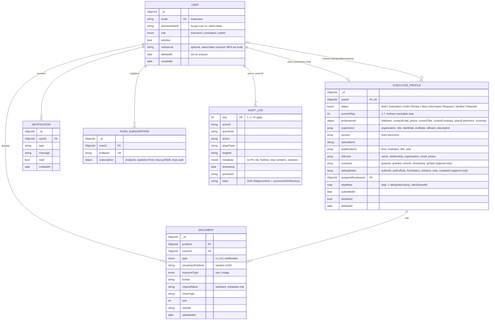

# Data model

MongoDB via Mongoose. Each collection's schema lives in `backend/src/models/` and is the single place where shape, enums and defaults are enforced. Request bodies are also validated with `zod` before they reach the model.

## Collection notes

**User.** Self-registration always creates `executive`; only an admin can change roles (`PATCH /admin/users/:id/role`), and an admin cannot change their own role or status. `passwordHash` and `mfaSecret` are `select: false`, so a query never returns them by accident; `toSafeJSON()` is the only serialiser used in responses. On erasure the email becomes `erased-<id>@erased.invalid`, the password becomes a random unusable hash, and `isActive=false`.

**ExecutiveProfile.** One per executive (unique `userId`). The wizard's steps map to fields. Sub-documents have no `_id`, so the stored draft can be re-validated against the same zod schemas at submission.
- `consents[]` is append-only. A change of mind is a new entry, so the full consent history is kept as evidence. `ipHash` is a salted SHA-256 of the client IP, never the raw IP.
- `vettingNotes[]` is append-only and is written with `$push` in a conditional update.
- `stepMeta` supports offline replay: a repeated `Idempotency-Key` is a no-op, and a save with an older `clientSavedAt` (clamped to server time) never overwrites newer data.
- On erasure, every personal field is cleared and note text becomes `[erased]`. The status transitions and consent records are kept for accountability.

**Document.** Metadata only; the bytes live in Cloudinary under a random `public_id` with authenticated delivery. `sha256` is computed on the validated in-memory buffer before upload and is returned with every download link, so the file can be checked for integrity. At most 10 documents per profile.

**AuditLog.** Append-only. The integrity guarantee comes from the hash chain, not from access control alone. `metadata` is normalised through JSON before hashing so it hashes the same after a database round trip. Entries never contain personal data: failed logins store a hash of the email, not the email. The audit log is therefore not affected by erasure, and the chain stays verifiable after a subject is erased.

**Notification / PushSubscription.** These hold the in-app fallback and push endpoints. Both are deleted on erasure. A push subscription is upserted by `endpoint`, so a browser that a second user signs into moves to that user.

## Indexes

| Collection | Index | Why |
|---|---|---|
| users | `email` unique | login lookup; prevents duplicates |
| executiveprofiles | `userId` unique, `status`, `isDeleted` | own-profile lookup; queue filter |
| documents | `profileId`, `ownerId` | listing; ownership checks |
| auditlogs | `seq` unique, `action` | chain ordering + fork prevention; filter |
| notifications | `userId` | inbox |
| pushsubscriptions | `endpoint` unique, `userId` | upsert; fan-out |
